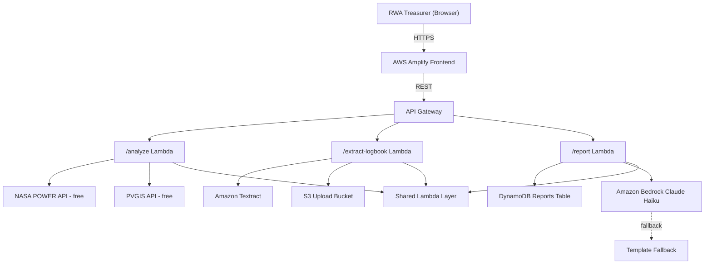

# 🌞 SunSwitch — DG-to-Solar Switch Advisor for Housing Societies

[](LICENSE)
[](https://aws.amazon.com/serverless/sam/)
[](https://wemakedevs.org/aws/env)

> **Environmental Hacks x AWS Hackathon** · Tracks: **Air** + **Waste & Energy**

## The Problem

Housing societies across Delhi-NCR (Noida, Ghaziabad, Gurugram) rely on diesel generator (DG) sets for power backup. This is:

- **Expensive:** DG power costs ₹13–18/kWh vs. ₹8–9/kWh from the grid
- **Polluting:** A typical 125 kVA DG set emits **48+ tonnes of CO₂/year** and raises local PM2.5
- **Opaque:** RWA committees have no simple tool to see their real DG cost or whether solar + battery makes financial sense

## The Solution

**SunSwitch** is a free web tool for RWA treasurers and secretaries. In under 5 minutes it produces:

1. **Real DG cost per kWh** — including diesel + maintenance, annualised
2. **DG emissions** — CO₂, PM2.5, NOx (all sourced/labeled)
3. **Solar potential** — from NASA POWER free API, with PVGIS cross-check
4. **Battery sizing** — for the society's typical outage hours
5. **Financial analysis** — payback period, 25-year NPV, PM Surya Ghar subsidy estimate
6. **Shareable bilingual report** — English + Hindi, printable for committee meetings

---

## Architecture



## AWS Services Used

| Service | Purpose | Why |
|---|---|---|
| **AWS SAM** | Infrastructure-as-code, one-command deploy | Open-source, hackathon eligible |
| **API Gateway** | REST API for all endpoints | Managed, pay-per-request |
| **Lambda (Python 3.12)** | `/analyze`, `/extract-logbook`, `/report` | Serverless, minimal cost |
| **Amazon Textract** | Extract data from DG logbook photos | Handles handwriting, tables, forms |
| **Amazon Bedrock (Claude Haiku)** | Generate plain-language summaries in English + Hindi | Cheapest Claude model; graceful fallback |
| **DynamoDB** | Store saved reports with TTL | PAY_PER_REQUEST, no fixed cost |
| **S3** | Logbook photo uploads via pre-signed URLs | 7-day lifecycle → no long-term PII |
| **AWS Amplify Hosting** | Host React frontend | Git-connected CI/CD, free tier |

---

## Calculation Model

All calculations are implemented as **pure, unit-tested Python functions** with zero side effects.

### Solar Energy Yield
```
E = A_usable × G × η × PR × T_loss × (1 - d)^(year-1)
```
Where:
- `A_usable` = roof area × usable fraction (default 60%) [ASSUMPTION]
- `G` = annual irradiance kWh/m²/yr — from **NASA POWER API** (lat/lon lookup)
- `η` = panel efficiency (default 20%, monocrystalline 2025) [ASSUMPTION]
- `PR` = performance ratio (default 75%) [ASSUMPTION]
- `T_loss` = temperature loss factor (default 95%) [ASSUMPTION]
- `d` = annual degradation rate (default 0.5%/yr) [ASSUMPTION]

### DG Cost per kWh
```
kWh = hours × kVA × load_factor × power_factor
cost/kWh = (litres × diesel_price + hours × maintenance_rate) / kWh
```

### Hand-Verified Example
| Input | Value |
|---|---|
| DG capacity | 125 kVA |
| Running hours | 200 hr/month |
| Load factor | 0.7 |
| Power factor | 0.8 |
| **kWh generated** | **200 × 125 × 0.7 × 0.8 = 14,000 kWh** |
| Diesel consumed | 2,400 L @ ₹98/L |
| Fuel cost | ₹2,35,200 |
| Maintenance | 200h × ₹15 = ₹3,000 |
| **Total cost** | **₹2,38,200** |
| **Cost/kWh** | **₹2,38,200 / 14,000 = ₹17.01/kWh** |

### Emission Factors

| Pollutant | Factor | Unit | Source |
|---|---|---|---|
| CO₂ | 2.68 | kg CO₂/litre diesel | IPCC 2006 Guidelines Vol.2 Ch.3 Table 3.2.2 |
| PM2.5 | 0.50 | g PM2.5/kWh | US EPA AP-42 Ch.3.3 **[ASSUMPTION — verify with CPCB]** |
| NOx | 9.0 | g NOx/kWh | US EPA AP-42 Ch.3.3 **[ASSUMPTION]** |
| SO₂ | 0.03 | g SO₂/litre | BS-VI diesel ≤10 ppm S **[ASSUMPTION]** |
| Grid CO₂ | 0.706 | kg CO₂/kWh | CEA CO2 Baseline Database v17 (2023-24) |

> All assumptions are **explicitly tagged** in the UI, report, and code.

---

## Project Structure

```
dg-solar-advisor/
├── backend/
│   ├── shared/
│   │   ├── calculations.py      # Pure calculation engine (no AWS deps)
│   │   ├── irradiance.py        # NASA POWER + PVGIS API client
│   │   └── test_calculations.py # 25+ unit tests, hand-verified
│   ├── analyze/handler.py       # /analyze Lambda
│   ├── extract/handler.py       # /extract-logbook Lambda (Textract)
│   └── report/handler.py        # /report Lambda (DynamoDB + Bedrock)
├── frontend/                    # React + Vite + TypeScript + Tailwind
│   └── src/
│       ├── App.tsx              # Step machine, demo mode
│       ├── components/          # UI, Charts (Recharts), MapPicker (Leaflet)
│       └── pages/               # ProfileStep, DGUsageStep, AnalysisStep, ReportStep
├── infra/template.yaml          # AWS SAM template
├── deploy.ps1                   # Windows one-command deploy
├── deploy.sh                    # Linux/macOS one-command deploy
├── amplify.yml                  # Amplify CI/CD build spec
└── docker-compose.yml           # LocalStack offline development
```

---

## Local Setup

### Prerequisites
- Node.js 18+
- Python 3.12+
- AWS CLI (for deployment only)
- AWS SAM CLI (for deployment only)

### Frontend (no AWS needed)

```powershell
cd frontend
npm install
npm run dev
# Open http://localhost:5173
# Click "Load Demo Society" for instant demo with no API
```

### Backend Unit Tests (no AWS needed)

```powershell
cd backend/shared
pip install pytest
pytest test_calculations.py -v
```

### Full Local Dev with LocalStack

```powershell
# Requires Docker
docker-compose up -d

# Frontend pointing to local API
cd frontend
echo "VITE_API_BASE=http://localhost:3000" > .env.local
npm run dev
```

---

## Deploy to AWS

### One-Command Deploy

```powershell
# Windows
.\deploy.ps1

# Linux/macOS
chmod +x deploy.sh && ./deploy.sh
```

### Manual Steps

```powershell
# 1. Build
sam build --template infra/template.yaml --base-dir .

# 2. Deploy (first time — guided)
sam deploy --guided --template infra/template.yaml

# 3. Get API URL
aws cloudformation describe-stacks --stack-name sunswitch-dev --query "Stacks[0].Outputs"

# 4. Set frontend env var
echo "VITE_API_BASE=https://<id>.execute-api.ap-south-1.amazonaws.com/dev" > frontend/.env.local

# 5. Deploy frontend to Amplify
# See amplify.yml — connect GitHub in Amplify Console
```

---

## 💰 Cost Control

Estimated AWS cost under demo/hackathon traffic:

| Service | Free Tier | Estimated Cost |
|---|---|---|
| Lambda | 1M requests/month | ~$0 |
| API Gateway | 1M calls/month | ~$0 |
| DynamoDB | 25 GB + 25 RCU/WCU | ~$0 |
| S3 | 5 GB storage | ~$0.01/month |
| Textract | 1,000 pages/month free | ~$0.015/page after |
| Bedrock Claude Haiku | Pay-per-token | ~$0.001/report |
| Amplify Hosting | 5 GB/15 GB bandwidth | ~$0 |

**Estimated total: < $1/month at demo scale.**

### ⚠️ Set a Billing Alarm (Strongly Recommended)

1. Go to [AWS Budgets](https://console.aws.amazon.com/billing/home#/budgets)
2. Create budget → **Cost budget** → $10/month
3. Add alert → 80% threshold → your email via SNS

---

## Privacy & Disclaimer

- **No PII stored.** Society names and inputs are stored only in DynamoDB with a 90-day TTL.
- Logbook upload images are deleted from S3 after 7 days.
- **Estimates only.** This tool does not constitute engineering advice. Engage a certified solar installer for a site survey before investing.
- Subsidy rates shown are as of mid-2025. Verify current rules at [pmsuryaghar.gov.in](https://pmsuryaghar.gov.in).

---

## Limitations & Assumptions

1. Solar irradiance from NASA POWER is a multi-year average — actual yield varies year to year.
2. Emission factors for PM2.5/NOx are from US EPA AP-42 (labeled as assumptions; Indian CPCB data preferred but less accessible).
3. Financial model assumes 100% solar self-consumption. Actual savings depend on net metering policy in each state.
4. Battery costs are market estimates for 2025 LFP technology.
5. PM Surya Ghar subsidy rates are subject to change — always verify before communicating to residents.

---

## Future Work

- [ ] Bulk analysis for RWA federations (multiple societies)
- [ ] State-specific net metering tariff data
- [ ] WhatsApp Bot integration for committee members
- [ ] DISCOM-specific tariff slabs (not flat rate)
- [ ] Integration with PM Surya Ghar application portal API
- [ ] Mobile app with camera capture for DG logbooks

---

## License

MIT License — see [LICENSE](LICENSE).

Built for **Environmental Hacks x AWS Hackathon** by Chirag Gaurav.
